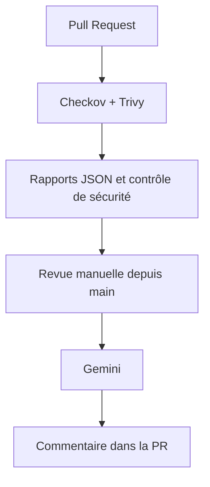

# Analyse de sécurité des pull requests

Checkov et Trivy détectent les problèmes de sécurité d’une PR. Gemini explique les constats et propose des corrections dans un commentaire GitHub.

[](https://github.com/Boualili-Youcef/DevSecOps_Scanner/actions/workflows/security-scan.yml)

## Fonctionnement



Le scan est automatique. La revue IA est lancée séparément depuis `main`, avec le numéro de PR. Elle met à jour le commentaire existant.

Le contrôle échoue sur tout échec Checkov, une vulnérabilité Trivy élevée ou critique, ou un système en fin de support. **L’IA ne décide pas du statut.**

Le commentaire présente les problèmes par priorité :

- **Explications détaillées** pour les vulnérabilités critiques ou élevées, les gravités non fournies et les échecs Checkov : risque, impact potentiel, correction, vérification après correction et incertitude.
- **Explications courtes** pour les autres constats, dans une section dépliable : problème, action et incertitude.
- **Rapport complet** `review-full.md`, téléchargeable dans l’archive `security-review` du workflow de revue. Si le commentaire est trop volumineux, il affiche explicitement le nombre de constats reportés dans ce document.

Les constats sont envoyés à Gemini par lots de cinq, sans plafond de cinq sur le rapport. Par défaut, la revue tente au plus 12 lots et cesse de démarrer de nouveaux appels après cinq minutes. En cas de limite atteinte, de panne ou de réponse invalide, les explications déjà validées sont conservées et tous les autres constats restent présentés avec les informations des scanners. La revue signale explicitement sa couverture partielle.

## Démarrer

Prérequis : Python 3.12, Docker et curl.

```bash
git clone https://github.com/Boualili-Youcef/DevSecOps_Scanner.git
cd DevSecOps_Scanner
python3.12 -m venv .venv
.venv/bin/python -m pip install -r requirements.txt
.venv/bin/python -m unittest discover -s tests
```

Commandes de test : [en local](docs/demo.md) ou [avec une PR GitHub](docs/pr.md).

## Démonstration

Le Terraform ouvre volontairement SSH à Internet et le Dockerfile utilise une ancienne image Alpine. Après restriction du réseau et mise à jour de l’image, les scans sont relancés sur la même PR.

Résultat local du 1er novembre 2026 : **Checkov 1 → 0**, **Trivy 1 → 0**. Constats observés : `CKV_AWS_24` et `CVE-2022-37434` dans zlib. Les résultats peuvent évoluer avec la base de vulnérabilités.

## Sécurité et limites

- La clé `GEMINI_API_KEY` reste dans l’environnement GitHub `gemini-review`, autorisé uniquement pour `main`.
- La revue vérifie la provenance des rapports et n’exécute aucun code de la PR. Seuls les changements dans `demo/` du même dépôt sont acceptés.
- Gemini utilise `gemini-3.5-flash-lite`, configurable par `GEMINI_MODEL`. Chaque requête contient cinq constats maximum ; la revue traite plusieurs lots. Ses recommandations restent à vérifier.
- Les tests utilisent des services simulés ; le parcours réel GitHub/Gemini reste à valider.
- **Ne jamais déployer le Terraform de démonstration.** Ce dépôt est un POC.
